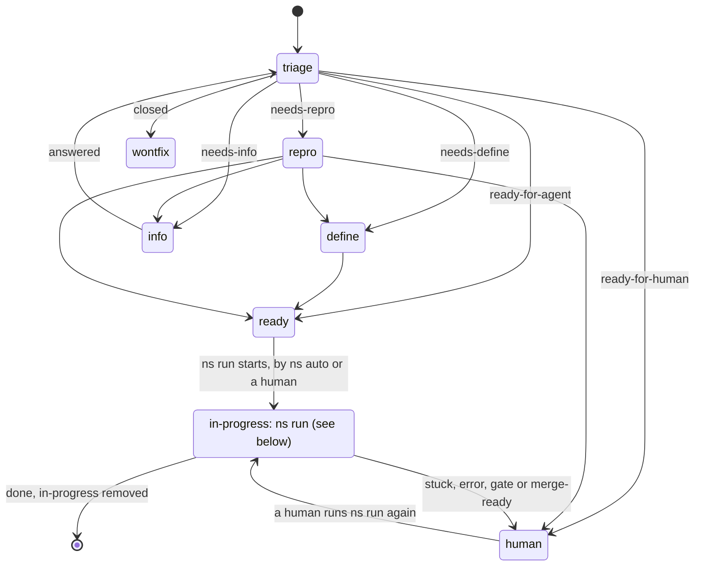
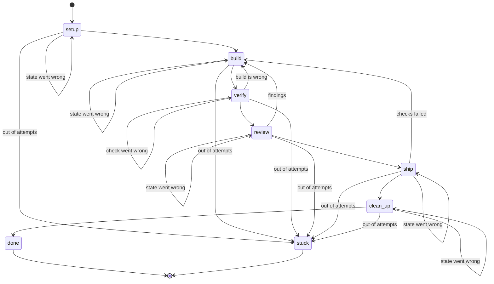

# States

## `ns auto`

A unit's `status:` label on the forge says where it is, and only `ns` changes it.

`ns auto` never resumes a unit. A unit that stopped is `ready-for-human`, so a human looks at it first and resumes it with `ns run <unit>`.

## `ns run`

The table in `cli/src/state.rs` is the source of truth.

`ns run <unit>` resumes a unit at the state it stopped or got stuck in. A unit stuck in `verify` or `review` whose workspace is exactly as the last build left it resumes at `build` instead: the check would judge the same code again, so the build is told the failing findings and changes it.

`verify` ends in one of three verdicts. `VERDICT: PASS` goes on to `review` and `VERDICT: FAIL` goes back to `build`. `VERDICT: INCONCLUSIVE` means no requirement failed but at least one could not be proven from the workspace (a live service, credentials, behavior only CI shows). It runs `verify` once more, shown the unproven requirements, and that verification's verdict decides as usual. When the second is inconclusive too, the unit is `stuck` with the reason `inconclusive` in the run log and `status:ready-for-human`, and a comment on the unit lists what is still unproven and what would make each checkable. The second verification counts against `max_attempts`, so with 1 the unit is stuck after the first. A unit stuck this way resumes at `verify`, not `build`, for the build has nothing to change.

`review` reads the change in six review areas: correctness, security, spec, tests, architecture, and docs and comments. `[review] sessions` in `.nightshift/nightshift.toml` is 1, 3 or 6 (3 by default; anything else is an error and nothing runs) and sets how the areas are shared among harness sessions, run one after another:

- **1**: one session reviews all six areas.
- **3**: behavior (correctness, security), requirements and tests (spec, tests) and maintainability (architecture, docs and comments).
- **6**: one session for each area.

Each session ends in `VERDICT: PASS` or `VERDICT: FAIL`. The review is `FAIL` when any session fails and `PASS` only when all pass, and `review-<n>.md` keeps a section for each session with its findings and verdict. A session that goes wrong (the harness did not finish, no verdict) makes the review go wrong: the state runs again from its first session. After a `FAIL` the build is told every session's findings, and the next review shows each session only its own findings that were not met.

`ship` merges the change request only when asked to (`--merge`) and when no file the branch changed matches `[merge] human_review` in `.nightshift/nightshift.toml`. Otherwise it labels the change request `needs-human-merge` and leaves it for a person. Before it pushes, `ship` rebases the branch onto the base branch if that has moved, moves the recorded base to the new tip, and runs `.nightshift/check` on the result; a conflict (the evidence names the files) or a failing check goes back to `build`, and `verify` and `review` do not run again for a clean rebase. A unit left for a person is brought up to date too: `ns run` on a `done` unit whose change request is still open does the same rebase, check and push, waits for the change request's checks, and prints `refresh` as `current` or `refreshed`; a conflict or failing check puts the unit back at `build` with the evidence in the printed move. It does so once per base tip (the run log keeps the tip), never from `ns auto`, and `ns status` shows each open change request as `current` or `behind` its base. A unit that is going to merge takes a lock on the repository before it fetches the base branch and holds it until the merge is made or the unit leaves `ship` (back to `build`, `stuck`, or the process ends), so units merge one at a time; a unit left for a person never takes it. Under the lock `ship` fetches the base branch again before the merge and, if a merge from outside `ns` moved it, goes round again; after `[merge] max_base_moves` moves the unit is `stuck` with the reason `base_moved`. The merge names the head commit that passed. `[merge] queue = false` turns all of this off.
