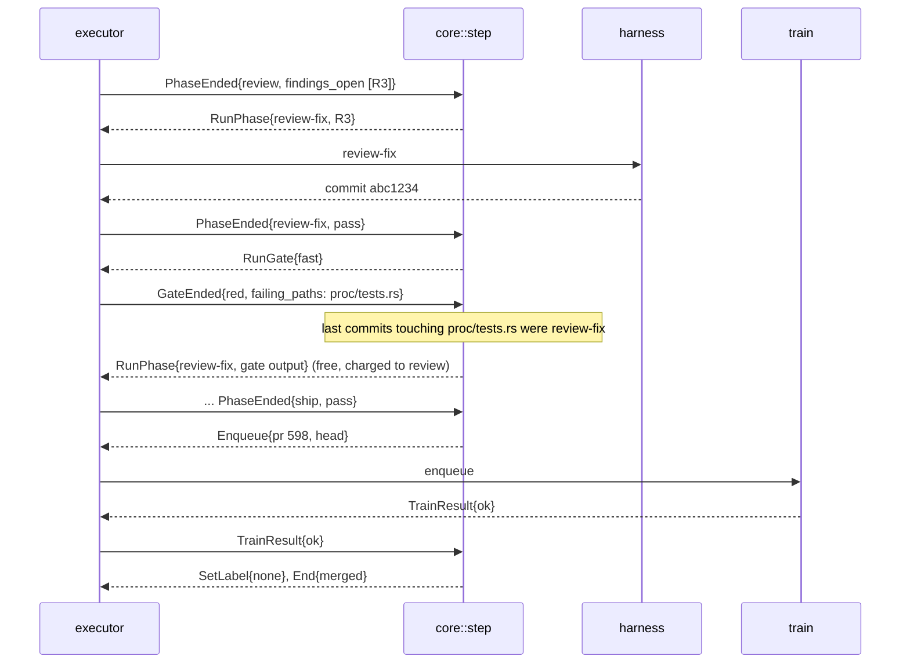

# One state machine per unit, merges that don't queue on CI, and no shared hot files

| | |
|---|---|
| Author | Claude Code session, for the owner |
| Team | nightshift |
| Reviewers | The owner: approve or change the five decisions in Open questions, and say which goals you would trade away first |
| Kind | Proposal |
| Version | 1, the first written design for the `ns run` and `ns watch` core |
| Key | CORE |
| Status | Draft |
| Last updated | 2026-10-14 |
| Requirements | No requirements doc. The goals are written here |
| Code | #562, #557, #559, #560, #561, #582, #583, #617, #610, #564 (to be refiled as the work below) |
| Related | `docs/DESIGN.md`, `docs/factory/run.md`, `docs/factory/merge.md`, ADR-444, ADR-466, `.git/ns/handoffs/backlog-review-2026-10-13.md` |

## Summary

`ns run` decides what a unit does next in a 490-line loop that mixes decisions with git, forge and gate I/O and keeps its counters in memory. Merges go one at a time, each holding a repo-wide lock through a GitHub CI wait. On 2026-10-13, a median unit took 105 minutes from start to merge, ran 8.1 phases instead of 5, and 8 of 43 runs ended stuck.

This design replaces the loop with a pure transition function over a persisted unit state, typed artifacts, and a fault-attributing router. Merges stop holding a repo-wide lock through CI, and a merge train that runs CI once per batch follows later. The files that most PRs edit are split so parallel units stop colliding.

It costs about two days of focused work on the core, done outside the factory with the existing 570 factory tests as the spec. Until it lands, the factory runs leaf work only.

## Problem

Measured from `<git-common-dir>/ns/runs.jsonl`, 2026-10-13 07:00 to 2026-10-14 00:00 Toronto, with 4 to 7 units running at a time:

| Measure | Value |
|---|---|
| Runs ended | 43: 27 merged, 5 done (needing a human merge), 3 split, 8 stuck |
| Phase runs | 220 for 27 merges, 8.1 per merge. A clean unit needs 5 |
| Verify runs | 55, of which 20 were reruns because `evidence.md` was no longer current |
| Gates gone red | 9: 5 after build, 4 after review |
| Start to merge | median 105 min (p25 68, p75 130) |
| Spend | $207 on phases, $7.70 per merge |

The causes, from the two surveys of the code (2026-10-14):

1. **Decisions are tangled with I/O and live in memory.** `drive()` (`cli/src/run/drive.rs:63-554`) reads state, takes locks, archives, launches phases, runs gates and calls `gh`, and makes routing decisions between those steps. `forced` decisions skip `decide()` entirely (`drive.rs:121-123`). Attempts, credits and `last_failure` are process-local (`drive.rs:73-97`), so a restart forgets them. Only 3 tests sit in `drive.rs`; the routing is tested end to end through `cli/tests/factory.rs` (15,454 lines, 570 tests). Each fix to attempt accounting has needed its own issue: #447, #584, #617.
2. **Every red gate goes back to build.** That includes one caused by a review commit (`drive.rs:550`) and a CI failure in the merge step (`merge.rs:186`). It costs build an attempt it didn't fail, and a full verify and review after it. This stopped #563 and #580 on 2026-10-13.
3. **A base move that touches a unit's lines reruns verify and review in full.** Artifact currency is all or nothing (`currency.rs:166-169`). #427 paid three full rounds for a few lines of conflict resolution.
4. **Artifacts are parsed with heuristics.** Malformed frontmatter turns into "stuck" or "rerun" depending on the file (`currency.rs:31`, `:284`, `:309`). Routing reads the body's first line and the first occurrence of "verify" or "review" (`currency.rs:219-253`). Two skill-side bugs on 2026-10-13 came from this contract: a denial line above the frontmatter, and a ship-only criterion blocking verify (#603).
5. **Merges are serial, and each one makes the others redo CI.** The merge lock is held through update-branch, a CI wait of up to 30 minutes and the merge (`merge.rs:233-321`). Each merge leaves every other open PR behind `main`, so each pays another update and CI run. That's 31 `update_branch` events for 27 merges, and N units cost about N squared over 2 CI runs.
6. **Parallel units collide in shared files.** Of the 254 PRs since 2026-10-08:
   - 94 edit `docs/FACTORY.md`;
   - 83 edit `cli/tests/factory.rs`;
   - 61 edit `cli/src/run.rs`;
   - 61 edit `docs/DESIGN.md`;
   - 48 edit `cli/README.md`;
   - 47 edit `cli/src/main.rs`.

   Overlap prediction exists (`brief.md` `touches:`), but it only reorders and never holds a unit back (`watch/scheduler/overlap.rs:141-161`). Any `cli/` merge drains the whole night for a self-update (`watch/self_update.rs:1-5`).
7. **Two writers own status labels.** These are `ns` (`watch.rs:213-273`, `scheduler.rs:379-768`) and the `ns-triage` skill (`skills/ns-triage/SKILL.md:111`, `:122`), each with its own copy of the state table (#409, #559).

**Why now:** the owner wants to run nightshift on other repos (`backlog-review-2026-10-13.md`, "Path to other repos"). Every cause above gets worse with more units, and #562, #557, #559, #560 and #561 all rewrite the same 2,000 lines one after another, through a factory slowed by those same causes.

## Requirements

### Goals

1. A clean unit (no conflict, nothing found in review) goes from start to merge in 60 minutes or less at 5 units in parallel. Today: 68 minutes at p25.
2. Phase runs per merged unit are 6 or fewer, averaged over a night. Today: 8.1.
3. No run ends stuck from attempt accounting, routing or the artifact contract over a night of at least 20 merges. A run stuck on a real decision or a missing repro doesn't count. Today: 4 of 43. Those were #427, #563 and #580 on attempt caps, and #563 again on a ship-only criterion. Separately, 1 run (#472) stopped on a harness denial, and 3 (#454, #499, #607) stopped for real decisions.
4. With 5 units ready to merge at once, CI runs on `main`-based heads total 3 or fewer for the batch when none conflicts. Today: 5 or more, plus updates.
5. Every routing rule has an in-process table test. The decision function does no I/O, and a full routing test suite runs in under 5 seconds.
6. No file outside `cli/src/run/core/` is edited by more than 15% of a night's PRs. Today: `docs/FACTORY.md` at 37%.
7. A restart of `ns run` mid-unit resumes with the same attempts, credits and pending action. No hand edits to artifacts.

### Values

| ID | Value | Source |
|---|---|---|
| CORE-1 | A delta re-check (verify and review of the interdiff only) applies when the interdiff is at most 40 changed lines and touches no file the unit's acceptance criteria name | decided (the owner, 2026-10-14) |
| CORE-2 | Merge train batch, when the train is built: up to 4 PRs per batch | estimate from 5 units in parallel; the train itself is deferred (the owner, 2026-10-14) |
| CORE-3 | Attempts per phase: 2 attempts that the phase itself caused. Attempts from base moves and other phases' faults are free, bounded by CORE-4 | config default today (`factory.rs:243`); the meaning is new |
| CORE-4 | Free reruns per unit: 6 per run, then the unit ends `stuck` with reason `rework-cap` | decided, this draft |

### Non-goals

- **GitLab.** Out of scope for this design (the owner, 2026-10-14: get GitHub working first). GitLab keeps today's merge step and labels as they are.
- **Changing what each phase skill does inside its phase.** Build, verify, review and ship keep their jobs; only their output contract (Interfaces) changes.
- **Remote or cloud runners** (#113). All units still run on one machine.
- **Cutting review's multi-provider panel.** That's a separate cost question (#425 measures it).

## Constraints

- **One laptop:** 16 cores, 24 GB for WSL, the C: drive as the only disk (`.wslconfig`, handoff 2026-10-13). About 5 units is the measured limit.
- **A personal GitHub account, so no GitHub merge queue.** It needs an organisation-owned repo (`docs/factory/merge.md:15`), which is why the train is built in `ns`.
- **Required checks report only on PR heads and pushes,** not on arbitrary scratch branches without a workflow trigger (`.github/workflows/ci.yml` triggers). The train therefore pushes a real branch, `ns/train-<n>`, that CI runs on.
- **The `main` ruleset doesn't require PRs to be up to date** (`strict_required_status_checks_policy: false`; it allows squash merges only, keeps history linear and requires 7 status checks; read 2026-10-14 with `gh api repos/noahdgrant/nightshift/rulesets`). A PR can merge once its own head is green, without being updated onto the latest `main`. Today's update-then-rerun-CI before every merge (`merge.rs:255-273`) is `ns`'s own safety step, not GitHub's. The train keeps that safety by testing the combined head instead. If the ruleset turns strict mode on, the train has to push each batch's result into the PR branches before merging, which doubles CI.
- **The harnesses are claude and codex CLIs,** launched one process per phase (`cli/src/run/phases.rs`). The design can't keep a session alive between phases.

## Architecture

```
ns watch (scheduler) ──claims──► ns run <unit> (executor) ──► phase harness (claude/codex)
      │                               │   ▲
      │                               ▼   │ events
      │                         core::step(state, event) -> (state, actions)   [pure]
      │                               │
      │                         .ns/<unit>/state.json   [persisted]
      ▼
 merge train (one per repo, inside ns watch, or `ns train` when there is no night)
```

- **`core`** (`cli/src/run/core/`): the pure transition function and its types. It owns every routing rule, attempt and credit.
- **The executor** (`cli/src/run/exec.rs`, replacing `drive.rs`): carries out one action at a time (run a phase, run a gate, push, enqueue for merge, write a label) and turns the result into an event. It holds no decisions.
- **The merge train** (`cli/src/train/`): takes PRs that are ready to merge, builds a batch head, waits for CI once, and merges the batch or bisects it.
- **The scheduler** (`cli/src/watch/scheduler/`): fills slots, now with hard overlap holds, and never drains for a self-update.

## Design

### How it works

**1. State and the transition function.** `.ns/<unit>/state.json` holds the unit's state:
- `phase`, the phase now running or due;
- for each phase: `attempts` (charged), `free_runs`, `last_result`;
- `gate`: the last result at each sha;
- `base_sha` and `train_ticket`.

`core::step(state, event) -> (state, Vec<Action>)` is the only place decisions happen. Events:
- `PhaseEnded{phase, artifact}`, where the artifact is typed and checked;
- `GateEnded{trigger, sha, green, failing_paths}`;
- `BaseMoved{new_sha, interdiff}`;
- `TrainResult{ok | conflict | red{paths}}`;
- `Timeout{phase}`;
- `Interrupted`.

Actions: `RunPhase{phase, feedback}`, `RunGate{kind}`, `ComputeInterdiff`, `Enqueue`, `SetLabel{label}`, `Archive{files}`, `End{outcome, reason}`.

The executor writes `state.json` (temp file, then rename) before it performs each action. So a restart replays the last pending action rather than guessing from artifacts.

**2. Fault attribution.** A red gate carries `failing_paths`: the files in compiler errors, failing tests and rule findings, parsed from the gate log's tail by the existing formats. `step` charges the fault to the most recent phase whose commits touched any failing path, and routes the fix back to that phase with the gate output as feedback:
- review's commits go back to a review fix cycle;
- build's go back to build;
- ship's merge resolution goes back to ship.

If no phase's commits touch a failing path, the base caused it (a semantic conflict): it routes to build, as a free run. This replaces `drive.rs:550` and `merge.rs:186`, and fixes #617.

**3. Currency by interdiff.** When the base moves, the executor computes the interdiff: `git range-diff` of the unit's diff before and after the update, reduced to changed lines per file. `step` then decides:
- **Empty interdiff:** every artifact stays current. Today's patch-id rule already does this (`currency.rs:166`).
- **Within CORE-1:** the artifacts stay, with `delta_of: <old sha>` added. Only the gate runs, plus one delta review of the interdiff.
- **Larger, or touching a criterion's files:** verify and review rerun in full, as today.

The gate always runs on the new head, so a semantic conflict is still caught. This fixes #582.

**4. Typed artifacts.** Each phase ends by writing its artifact. `ns` then validates it (`ns artifact check`, run by the executor, not left to the skill) against the schema in Interfaces. An invalid artifact is a `PhaseEnded` with `artifact: Invalid{errors}`, and `step` reruns the same phase once with the errors as feedback; that run is free. Routing reads `cause` and `next`, never the body. This fixes #557 and #603's class.

**5. Review cycles as runs.** Review runs one cycle per phase run. Its artifact says `cause: findings_open` with the finding IDs, or `pass`. `step` runs the fix cycle as a review-fix phase run and then the next review cycle, bounded by `cycles` (today's 5, `nightshift.toml:33`). A review-fix commit goes through pre-commit with the ast-grep rules (#621). This fixes #560.

**6. Labels from the table.** `step` emits `SetLabel` from one table, mapping state to label (`ready`, `in-progress`, `in-review`, `split`, `ready-for-human`). Skills never write `status:*`. `ns-triage` reports `next: build | define | troubleshoot | human | split`, and `ns` applies the label. This fixes #559 and #409.

**7. Merging: optimistic first, the train later.** The owner chose (2026-10-14) to ship the simple step first:

- **Optimistic merge (ships first).** The unit runs update-branch, if the PR is behind, and the CI wait **without** the merge lock. It takes the lock only for the final check: is the PR head still the head CI passed on, is its merge base still `origin/main`'s sha from when CI started, or does the PR merge cleanly with no changes in the unit's lines? Then it calls `gh pr merge --squash --match-head-commit`. If `main` moved in between, the unit releases the lock and repeats the update and CI, as a free run bounded by CORE-4. Waiting units no longer queue behind one unit's 9-minute CI wait. Each unit still pays its own CI run, so Goal 4 isn't met in this step.
- **Merge train (follow-up, below).** Batching CI runs is what meets Goal 4, and it's built once the optimistic step has run for a night.

**Merge train (follow-up).** A unit whose ship passed sends `Enqueue` with its PR and head. The train coordinator runs inside `ns watch`, or as `ns train` from a lone `ns run`, under the existing merge lock. That lock is now held only while it builds a batch, never across CI:
1. Take up to CORE-2 queued PRs in queue order. Create `ns/train-<n>` from `origin/main`, then merge each PR head into it in order. A PR that conflicts drops out with `TrainResult::conflict`, and its unit goes to ship to resolve it.
2. Push `ns/train-<n>` and wait for its required checks, with the lock released. New PRs queue for the next batch.
3. **Green:** for each PR in order, `gh pr merge --squash --match-head-commit <head>` onto `main`. No PR gets a second CI run, because a later PR's squash lands a tree identical to the train's at that point; the coordinator checks that the trees match. Then `TrainResult::ok`.
4. **Red:** split the batch in half and run the first half as its own train, then the second (bisection). The failing PR gets `TrainResult::red{paths}`, which routes through fault attribution (2). If it's the base, the unit goes to build.

With no conflicts and a green train, 5 PRs take 2 CI runs (batches of 4 and 1, by CORE-2), not 5 to 15 (Goal 4).

**8. Scheduler.** `touches` overlap becomes a hard hold. A ready unit that overlaps a running unit waits, unless the overlapping paths are all on `overlap_ignore` (generated files and the split registries below). The executor records each unit's real changed files against its `touches` in `runs.jsonl` (`touches_miss`), so triage can learn from misses.

Self-update no longer drains the night. A new unit starts on the newest binary (`~/.local/share/nightshift/bin/ns-<sha>`), and running units finish on theirs. Units already pin their binary in the child command line (`scheduler/child.rs:22-90`). The triage pass runs as its own slot, not inside `fill` (`scheduler.rs:335`).

**9. Registries split for parallel work** (Goal 6). Each change ships on its own, through the factory, before or alongside the core:
- `docs/FACTORY.md` becomes an index of links only, with one page per feature under `docs/factory/`. A new feature adds a page and one link line.
- `cli/tests/factory.rs` becomes per-feature files `cli/tests/factory/<feature>.rs`, sharing a harness module.
- `cli/src/main.rs` dispatch becomes a per-command registration, like the per-command args from #498.
- `docs/DESIGN.md` keeps decisions out of its body (ADRs are already per file) and has no per-change edits.
- `cli/README.md` links to `docs/cli/<command>.md` and stops restating them.
- `.nightshift/rules-baseline.json` stores no line numbers (#610), and fixed entries drop out without a human merge (#564).

### Interfaces and contracts

**Artifact frontmatter, before:**

```yaml
unit: 580-...
phase: verify
status: pass | fail | blocked
sha: 07ec50a
updated: 2026-10-13T22:27:00Z
```

Routing came from `status`, plus the body's first line, plus words in it.

**After** (schema `ns-artifact/2`, validated by `ns artifact check <file>`):

```yaml
schema: ns-artifact/2
unit: 580-...
phase: verify            # triage | troubleshoot | build | verify | review | review-fix | ship
status: pass | fail | blocked | split
cause: none | findings_open | criteria_failed | gate_red | base_moved | denied | needs_human | out_of_scope
next: none | build | verify | review | ship | define | troubleshoot | human
reason: "one line a human reads"
sha: 07ec50a
delta_of: 9659e41        # optional: this artifact carries forward an earlier one over a small interdiff
findings: [R3, R7]       # review only
updated: 2026-10-13T22:27:00Z
```

**Old meets new.** `ns` reads `ns-artifact/1` (no `schema` key) by mapping today's rules onto `cause`/`next`, and warns. Skills write `/2` from the release that ships the schema. A `/2` artifact read by an older `ns` parses: unknown keys are ignored (`frontmatter.rs:31-41`), and `status`, `sha` and `pr` keep their meaning.

**`state.json`** (new, `.ns/<unit>/state.json`, schema `ns-unit-state/1`): fields as in How it works (1). An `ns run` that finds no `state.json` derives it from the artifacts with today's `decide()`, once, then continues.

**CLI:**
- New: `ns artifact check <file>` (JSON result, exit 1 on invalid); `ns train [--dry-run]`; `ns run --explain <unit>`, which prints `state.json` and the next action.
- Unchanged: the `ns run` and `ns watch` flags.

**Labels:** the same names as `docs/agents/triage-labels.md`. Only the writer changes.

### State and data

- `state.json` lives in the unit's `.ns/` directory, next to the artifacts, and is owned by the unit's `ns run` under the run lock (`locks.rs:25`). It's removed with the worktree.
- Train state lives in `<git-common-dir>/ns/train/queue.jsonl` (append-only, under the merge lock) and on the `ns/train-<n>` branches, which the coordinator deletes after the merge or bisection.
- No migration is needed for in-flight units: the first `ns run` on the new binary derives `state.json`. Reversible: the old binary ignores `state.json`.

### Diagram



## Alternatives considered

- **Do nothing; finish the plan as filed** (#562, then #557 and the rest through the factory). It reaches the same code in pieces, but each piece rewrites `drive.rs` again: about 6 serial units of 80 to 150 minutes, each paying today's rework rate. It's also missing the merge train and the registry splits, so Goals 4 and 6 stay unmet. It lost on time: about two days through the factory versus about two days of focused work that also includes the train.
- **Rewrite everything on a new branch.** That's 49k lines of source, 30k of tests and 142 closed bug fixes encoded in tests (counted 2026-10-14). It would rediscover those bugs, and the factory would stall meanwhile. It lost on risk and time.
- **GitHub's merge queue instead of a train.** It's the obvious tool, but it needs an organisation-owned repo (Constraints). It would be revisited if the repo moved to an organisation; the train's Enqueue action would map onto it.
- **Optimistic merge (release the lock during CI, retry on a moved base) without batching.** It's simpler, but it keeps N CI runs for N PRs and adds retries. It's kept as the fallback when a batch is 1.
- **One long-lived agent session per unit instead of phase runs.** It would avoid re-reading context each phase, but it can't be pinned, timed out or resumed with today's harness CLIs (Constraints), and it loses fresh-context review.

## Failure modes and risks

| What fails | Detection | What happens next | Spread |
|---|---|---|---|
| `state.json` torn by a crash mid-write | rename is atomic; a parse error at start | derive from the artifacts, as for a unit with no state, and log `state_rederived` | one unit |
| Two `ns run` on one unit | the run lock (`locks.rs:111`) | the second exits 5, as today | none |
| Fault attribution blames the wrong phase | `touches_miss`-style audit: the fix run's diff doesn't touch the failing paths | the free run is spent, then the failure is charged to build; bounded by CORE-4 | one unit |
| Interdiff judged small but semantically breaking | the gate on the new head, and train CI | gate red, fault attributed to base, so build | one unit |
| Train CI flaky | a red result whose bisected halves are both green | rerun the batch once; a second flaky red ends the batch and files a flaky-test issue with the job URL | that batch, delayed one CI cycle |
| Train bisection on a large batch | count of train CI runs per batch over 2× the batch size | cap bisection depth at 2; the remainder go one at a time | that batch |
| A squash merge tree differs from the train tree (`main` moved by a human) | tree compare before each merge | stop the batch, re-enqueue the rest at the front | that batch |
| An old skill writes `/1` artifacts after the switch | `schema` missing; a warning in `runs.jsonl` | mapped by the `/1` reader | none |
| Hard overlap holds starve a unit that overlaps everything | queue wait over 2 hours (decided, the owner 2026-10-14) | after 2 hours, start it anyway and log `overlap_forced` | one unit |
| A self-update binary is broken | the first unit on it fails at start | the next unit uses the previous binary; the night files fix-main | units started on the bad binary |

## Privacy

No change. The paths carry repo code, issue numbers, labels and CI results; no personal data beyond the GitHub account names already in use.

## Security

One change. The train pushes `ns/train-<n>` branches to `origin` with the same token and permissions ship already uses to push `ns/<unit>` branches. No new credential or permission. A train branch is deleted after use and is never merged itself: only the PRs are squash-merged, each with `--match-head-commit`.

## Validation

- **Routing:** every row of the transition table has a `core` unit test; target 150 or more table rows, run under 5 s (Goal 5). The 570 `cli/tests/factory.rs` tests keep passing against the new executor, as the behaviour spec, apart from tests this design changes on purpose (attribution, interdiff, labels), which are rewritten first.
- **Merge train:**
  - an integration test with the fake `gh` running batches of 1, 4 and 5, with one conflict and one red PR, checking CI runs and merge order;
  - then one supervised day on this repo.
- **Night metrics** from `runs.jsonl`, first full night after rollout, at 5 units:

  | Metric | Target | Goal |
  |---|---|---|
  | Clean unit, start to merge, p50 | 60 min or less | Goal 1 |
  | Phase runs per merge | 6 or fewer | Goal 2 |
  | Runs stuck on accounting, routing or the artifact contract | 0 | Goal 3 |
  | CI runs per batch of 5 | 3 or fewer | Goal 4 |

- **Rollback trigger:** two nights in a row with more phase runs per merge than 2026-10-13 (8.1), or with more runs stuck on accounting, routing or the artifact contract than that day (4 of 43).

## Rollout and back-out

Each step ships on its own and is reversible:
1. **Registry splits** (9), through the factory now, in parallel: they're leaf work and unblock parallel units at once.
2. **`core` and `state.json`** behind today's behaviour: the same routing, now table-driven, with `state.json` persisted. The 570 factory tests must pass unchanged. (Replaces #562 and #617's accounting part.)
3. **Typed artifacts:** `ns artifact check` and the `/2` schema in the skills, with the `/1` reader kept. (Replaces #557.)
4. **Fault attribution and interdiff currency.** (Replaces #617 and #582.)
5. **Labels from the table**, with skills no longer writing `status:*`. (Replaces #559.)
6. **Review cycles as runs.** (Replaces #560.)
7. **Optimistic merge:** the lock is held only for the final check and merge. (Replaces #561.) Then the **merge train** as a follow-up, behind `[merge] train = true`, off by default until it has run for one supervised day.
8. **Scheduler hard holds and no-drain self-update** (#583).

**Back-out:**
- Steps 2 to 6: run the previous `ns-<sha>` binary. It ignores `state.json` and reads `/2` artifacts as `/1`.
- Step 7: the previous binary for optimistic merging; `[merge] train = false` for the train.
- Step 8: `overlap_ignore = ["**"]` disables holds.

None of the steps migrates data irreversibly.

## Open questions

| Question | Owner | Needed by |
|---|---|---|
| When to build the merge train: after one night of optimistic merging, or only if CI per merge stays the bottleneck? | The owner | after step 7 |

Settled 2026-10-14 by the owner:
- CORE-1 as written.
- Optimistic merging first; the train later.
- The core (steps 2 to 6) built in one interactive session and reviewed as one PR.
- GitLab out of scope.
- Overlap holds: a unit waits up to 2 hours, then starts anyway. `overlap_ignore` holds only the files part 9 splits, each removed once it's split.

## References

- Survey of the `ns run` core, 2026-10-14: `drive.rs`, `currency.rs`, `merge.rs`, `ci_gate.rs`, `gate.rs`, with file and line references, in this session's notes.
- Survey of `ns watch`, labels, locks, artifacts and hot files, 2026-10-14.
- `runs.jsonl` measurements, 2026-10-13 07:00 to 2026-10-14 00:00 (Problem table).
- `.git/ns/handoffs/backlog-review-2026-10-13.md` (path to other repos).
- Issues #562, #557, #559, #560, #561, #582, #583, #584, #617, #610, #564, #621, #409.
