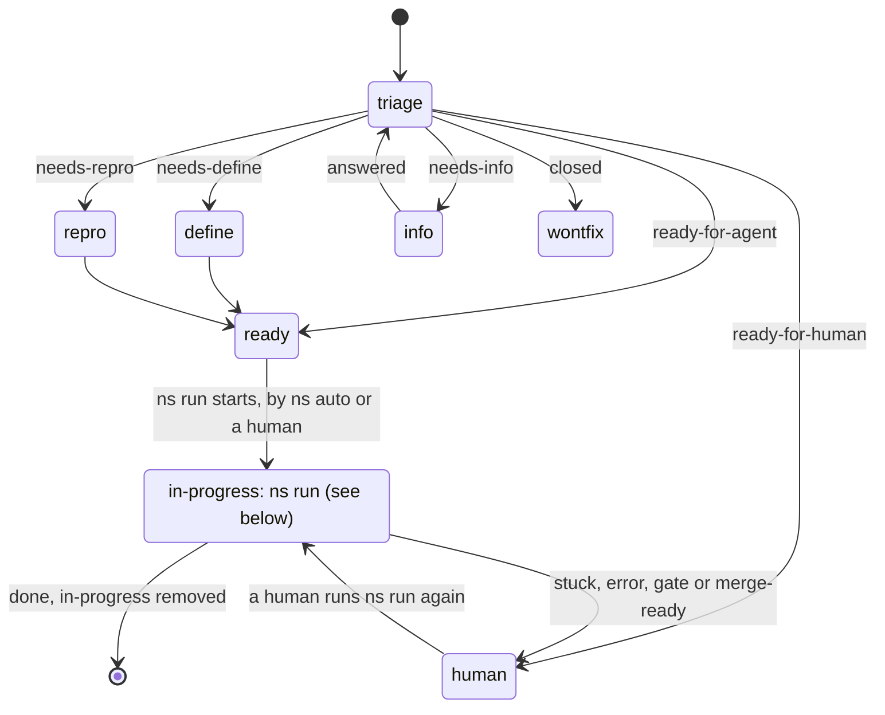
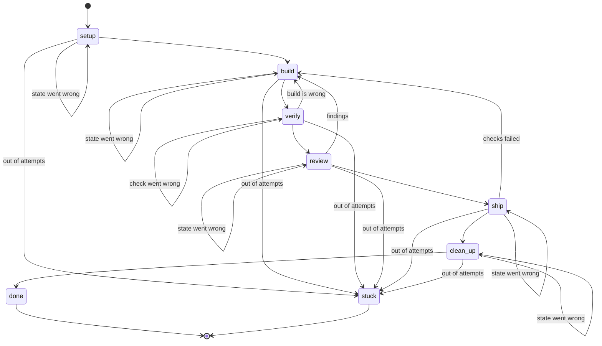

# States

## `ns auto`

A unit's `status:` label on the forge says where it is, and only `ns` changes it.

`ns auto` never resumes a unit. A unit that stopped is `ready-for-human`, so a human looks at it first and resumes it with `ns run <unit>`.

## `ns run`

The table in `cli/src/state.rs` is the source of truth.

