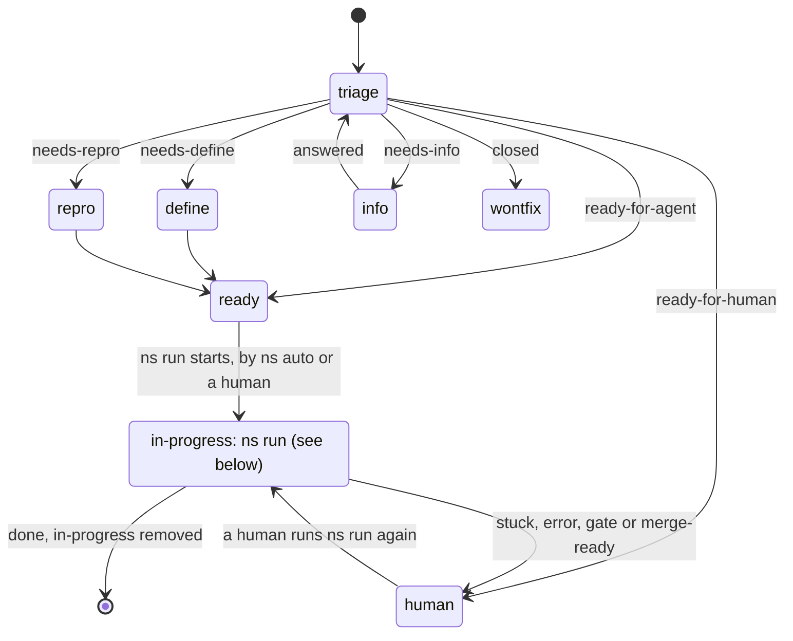
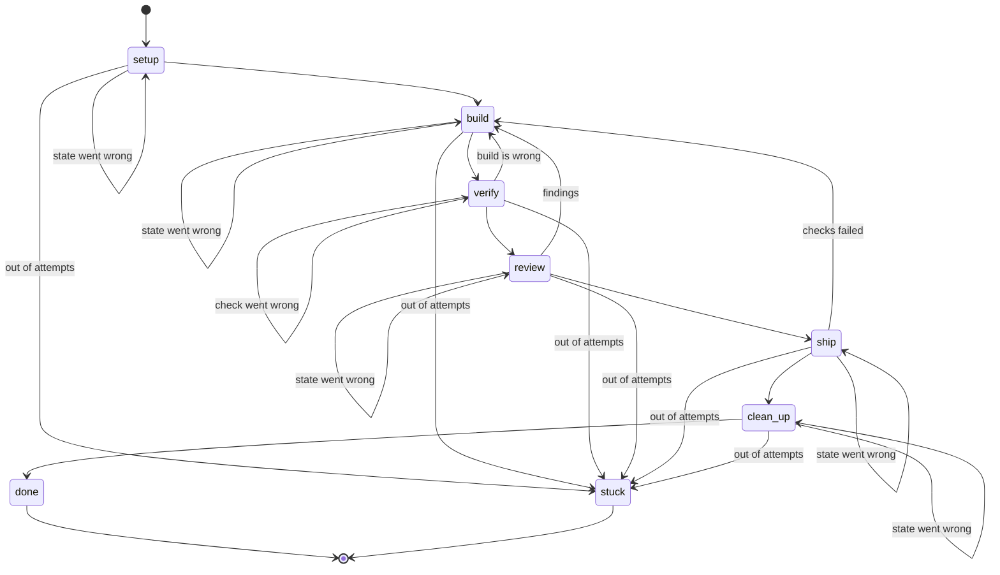

# States

## `ns auto`

Where a unit is before, during and after its run. A unit's `status:` label on the forge records it, and `ns` is the only one that changes that label. Triage decides the first label. `ns auto` runs only ready units.

- `ns run` marks a unit `in-progress` when it starts, and takes the label off when the unit reaches `done`. The merged change request closes the unit.
- When `ns run` ends any other way, it sets `ready-for-human`: the unit is `stuck`, `ns run` itself failed, it waits at a gate, or the change request is ready to merge and `--merge` was not given.
- `ns run` holds a lock on its unit, so a unit is never run by two at once, and `ns auto` holds one on the repository, so two never run together.
- `ns auto` first triages every untriaged unit, then runs the ready ones one at a time, up to `--max-units`. It only chooses. It runs `ns run <unit>` on units that are `ready-for-agent`, so it never picks up a unit that stopped. A human resumes a `ready-for-human` unit with the same `ns run <unit>`, which goes on from the run log.
- `ns triage` triages up to N units that nobody has triaged, and `--all` triages every one.

## `ns run`

The table in `cli/src/state.rs` is the source of truth.

