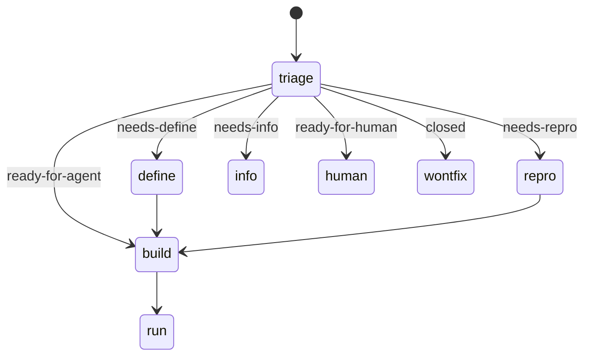
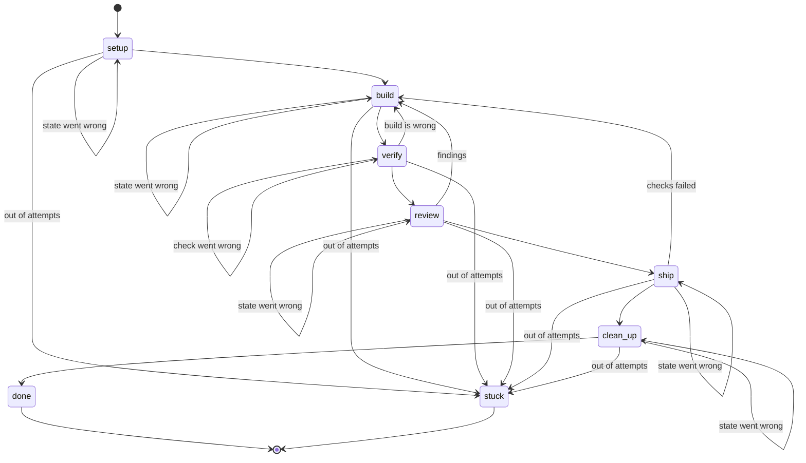

# States

## Before `ns run`

`ns watch` triages a unit, and its route sets the unit's state label on the forge. Only `build` leads to `ns run`. `define`, `repro` and the waiting routes are not built yet.

## `ns run`

How a unit moves through `ns run`. The table in `cli/src/state.rs` is the source of truth.

