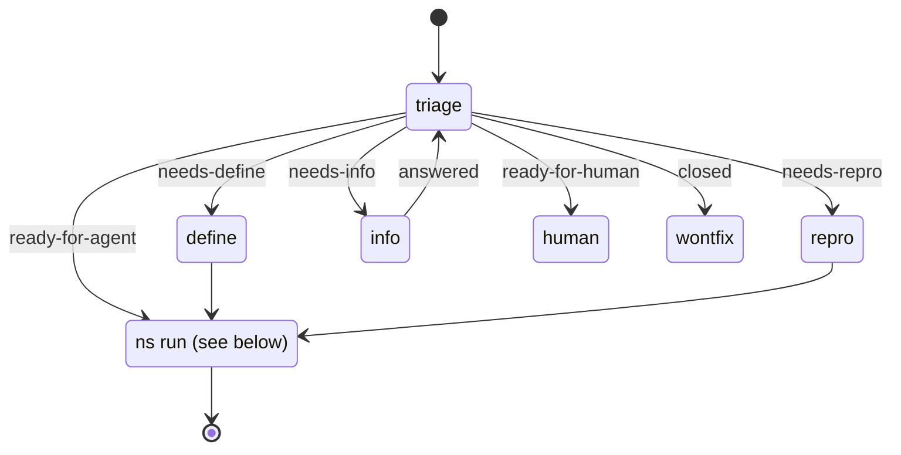
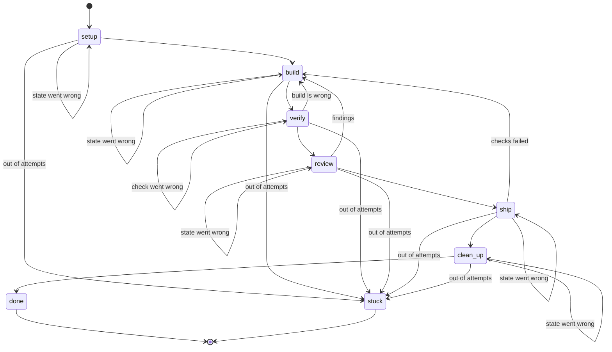

# States

The table in `cli/src/state.rs` is the source of truth for `ns run`.

## `ns auto`

Where a unit goes before it is run. Triage decides, and the unit's label on the forge records it. Only a ready unit goes to `ns run`; `define`, `repro` and the waiting states are not built yet.

## `ns run`

